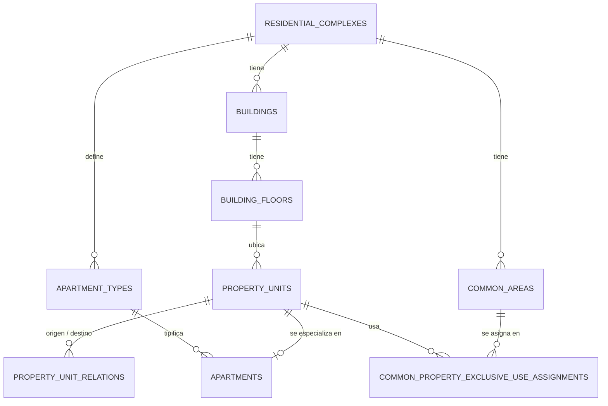

# Ziruma360 — Core de administración del conjunto

**Documento:** Base del núcleo (previo al módulo de rentas cortas)
**Versión:** 0.1 — borrador de trabajo
**Fecha:** 18 de octubre de 2026
**Stack:** Laravel 13 · PostgreSQL · Vue 3 + TypeScript · Inertia.js · Vite · Tailwind CSS · Pest
**Fuentes:** *Visión general del proyecto* y *Especificación funcional y técnica* (Fase 1)

---

## 0. Propósito y alcance

Este documento define **el núcleo sobre el que se montará todo lo demás**. Primero se construye el conjunto residencial como *tenant*, luego su estructura física y después las personas y sus relaciones con los inmuebles. Solo cuando esto esté sólido se pasa al módulo de rentas cortas.

| Bloque | Qué resuelve | Estado |
|---|---|---|
| **A. Conjunto residencial (Tenant)** | Identidad, configuración, usuarios, permisos y políticas propias | Este documento |
| **B. Configuración inicial** | Orden y contenido del alta de un conjunto | Este documento |
| **B.1 Estructura física** | Torres, pisos, apartamentos, tipologías, parqueaderos y áreas comunes | Este documento |
| **B.2 Personas y relaciones** | Propietarios, residentes, arrendatarios, empleados y visitantes | Este documento |
| **C. Módulo de rentas cortas** | Estancias, visitantes, vehículos, parqueo comunitario, portería | Siguiente documento |

### Convenciones

Se mantienen los prefijos de la especificación: `FUN` funcional · `RN` regla de negocio · `DAT` datos · `SEG` seguridad · `ACE` criterio de aceptación · `TEC` técnico.
Los puntos marcados **[Propuesta]** son recomendaciones para poder avanzar y deben confirmarse. Los marcados **[Ajuste]** son cambios o ampliaciones respecto a los documentos originales (se listan en la sección 8).

---

## 1. Conjunto residencial (Tenant)

El conjunto es la **entidad de aislamiento de datos**: todo lo operativo cuelga de él y nada se comparte entre conjuntos salvo los usuarios globales.

### 1.1. Identidad

| Campo | Tipo | Notas |
|---|---|---|
| `id` / `uuid` | bigint / uuid | `uuid` para exponer en URLs y APIs |
| `name` | string | Nombre comercial del conjunto |
| `code` | string, único | Slug corto estable (ej. `torres-del-mar`) |
| `legal_identifier` | string, nullable | NIT / personería jurídica |
| `address`, `city`, `state` | string | Ubicación |
| `country_code` | char(2) | `CO` por defecto |
| `timezone` | string | `America/Bogota`; base para convertir fechas UTC |
| `currency_code` | char(3) | `COP` por defecto |
| `status` | enum | `draft`, `active`, `suspended`, `archived` |
| `settings` | JSONB | Políticas del conjunto (ver 1.4) |
| `created_at`, `updated_at` | timestamps | |

**FUN-C01.** Un administrador de plataforma puede crear un conjunto y asignarle su primer administrador (por invitación).
**FUN-C02.** Un conjunto en estado `suspended` o `archived` no permite operaciones de escritura, y conserva su historial.
**RN-C01.** `code` es inmutable una vez el conjunto está `active` (evita romper enlaces e integraciones).

### 1.2. Usuarios y membresías

Los **usuarios son globales**; los **permisos viven en la membresía**, no en el usuario.

```
users (global) ──< residential_complex_memberships >── residential_complexes
                              │
                              └──< membership_roles >── roles
```

**`residential_complex_memberships`**

| Campo | Notas |
|---|---|
| `residential_complex_id`, `user_id` | `UNIQUE (residential_complex_id, user_id)` |
| `status` | `invited`, `active`, `suspended`, `revoked` |
| `invited_by`, `invited_at`, `joined_at` | Trazabilidad de la invitación |
| `last_active_at` | Opcional, útil para seguridad |

**FUN-C03.** Flujo de alta de usuario: invitación por correo → activación → selección de conjunto activo.
**FUN-C04.** Un usuario con varias membresías elige el **conjunto activo**; cambiarlo recarga el contexto de permisos.
**RN-C02.** Una membresía `suspended` o `revoked` bloquea el acceso al conjunto, pero **no** borra su historial ni las relaciones de la persona con los inmuebles.
**SEG-C01.** El conjunto activo se resuelve en el servidor (sesión + verificación de membresía vigente en cada request), nunca confiando en un ID enviado por el cliente.

### 1.3. Roles y permisos

**[Propuesta] Modelo:** permisos como catálogo versionado en código (enum), roles configurables por conjunto, y un **alcance** que decide si el permiso aplica a todo el conjunto o solo a inmuebles asignados.

| Tabla | Campos clave |
|---|---|
| `roles` | `residential_complex_id` (nullable = rol de sistema), `key`, `name`, `is_system`, `is_editable` |
| `role_permissions` | `role_id`, `permission_key` |
| `membership_roles` | `membership_id`, `role_id`, `valid_from`, `valid_until` |

**Roles de sistema iniciales** (se siembran al crear el conjunto):

| Rol | Alcance por defecto | Responsabilidad |
|---|---|---|
| `platform_admin` | Plataforma | Gestión SaaS (no es rol de conjunto) |
| `complex_admin` | Todo el conjunto | Configuración, estructura, personas, políticas |
| `doorman` (portería) | Todo el conjunto, datos mínimos | Validación y registro de accesos |
| `owner` (propietario) | Sus inmuebles | Consulta y gestión de lo que le pertenece |
| `co_owner` (copropietario) | Sus inmuebles, limitado | Según sus derechos |
| `resident` | Su unidad | Consulta de su unidad y su núcleo |
| `tenant` (arrendatario) | Su unidad, limitado | Según contrato y delegación del propietario |
| `host` (anfitrión) | Inmuebles autorizados | Se activa en el módulo de rentas cortas |

**Matriz de permisos del core** (✓ permitido · P solo recursos asignados · — no permitido por defecto):

| Funcionalidad | Plataforma | Admin conjunto | Portería | Propietario | Residente / Arrendatario |
|---|:-:|:-:|:-:|:-:|:-:|
| Crear / suspender conjunto | ✓ | — | — | — | — |
| Editar configuración y políticas | — | ✓ | — | — | — |
| Gestionar usuarios y membresías | — | ✓ | — | — | — |
| Gestionar torres, pisos, tipologías | — | ✓ | — | — | — |
| Consultar estructura física | — | ✓ | P | P | P |
| Gestionar unidades y apartamentos | — | ✓ | — | P (datos limitados) | — |
| Gestionar titularidad | — | ✓ | — | — (solo solicita) | — |
| Gestionar ocupantes de su unidad | — | ✓ | — | P | P (según rol) |
| Gestionar empleados del conjunto | — | ✓ | — | — | — |
| Gestionar empleados de su unidad | — | ✓ | — | P | P (si se delega) |
| Consultar datos personales | — | ✓ | P (mínimos) | P | P |
| Consultar auditoría | ✓ | ✓ | — | — | — |

**SEG-C02.** Cada operación valida en el backend: membresía activa → permiso del rol → alcance (conjunto o inmueble). La UI solo oculta, no protege.
**SEG-C03.** Las **Policies** de Laravel centralizan estas verificaciones. Se prohíbe consultar modelos tenant-scoped sin pasar por el contexto del conjunto.
**RN-C03.** Los roles de sistema no se eliminan; los administradores pueden crear roles adicionales combinando permisos del catálogo.

### 1.4. Políticas propias del conjunto

Cada conjunto define sus reglas sin que exista una aplicación distinta por conjunto. **[Propuesta]** Las políticas se guardan en `settings` (JSONB) pero **se leen y escriben a través de clases tipadas** con validación explícita (DTO / enum / `FormRequest`). Nunca JSON libre para reglas críticas.

| Grupo de políticas | Ejemplos (core) |
|---|---|
| **Regional** | Zona horaria, moneda, formato de fecha |
| **Usuarios y accesos** | Quién puede invitar usuarios, caducidad de invitaciones, política de contraseñas / 2FA |
| **Personas y documentos** | Tipos de documento aceptados, campos obligatorios por tipo de persona |
| **Titularidad** | Nivel de verificación documental exigido para registrar propietarios |
| **Privacidad y retención** | Plazos de conservación por tipo de dato, texto de autorización de tratamiento (Ley 1581 de 2012) |
| **Módulos** | Módulos habilitados y su configuración propia |

Las políticas específicas de rentas cortas (aprobación de estancias, horarios, reglas de vehículos) se definen en el siguiente documento.

**RN-C04.** Todo cambio de políticas queda auditado (quién, cuándo, valor anterior y nuevo) y **no reescribe** registros históricos.
**TEC-C01.** Los módulos habilitados viven en `residential_complex_modules` (`module_key` único por conjunto, `enabled`, `settings`).

### 1.5. Aislamiento multi-tenant

- **TEC-C02.** Toda tabla operativa lleva `residential_complex_id` (NOT NULL).
- **TEC-C03.** Trait `BelongsToComplex` + *global scope* que filtra por el conjunto activo; los jobs y comandos deben recibir el conjunto explícitamente.
- **TEC-C04.** **FKs compuestas** para impedir cruces entre conjuntos. Patrón:

```sql
-- En la tabla padre
ALTER TABLE buildings ADD CONSTRAINT buildings_id_complex_uq
  UNIQUE (id, residential_complex_id);

-- En la tabla hija
ALTER TABLE building_floors ADD CONSTRAINT floors_building_fk
  FOREIGN KEY (building_id, residential_complex_id)
  REFERENCES buildings (id, residential_complex_id);
```

- **ACE-C01.** Un usuario del conjunto A recibe 403/404 al pedir por ID un recurso del conjunto B, incluso vía endpoint directo.
- **ACE-C02.** Es imposible (a nivel de BD) asociar un piso, unidad o persona con un registro de otro conjunto.

### 1.6. Auditoría base

`audit_logs` (`residential_complex_id`, `actor_user_id`, `action`, `entity_type`, `entity_id`, `before_data`, `after_data`, `occurred_at`, `correlation_id`).
Se audita desde el inicio: membresías, roles, políticas, titularidad, ocupantes, estructura física. Nunca se guardan contraseñas ni credenciales en los snapshots.

---

## 2. Configuración inicial del conjunto

Orden recomendado de alta (asistente de configuración / *onboarding*). Cada paso depende del anterior, y el conjunto solo pasa a `active` cuando los pasos obligatorios están completos.

| # | Paso | Obligatorio | Resultado |
|--:|---|:-:|---|
| 1 | Crear conjunto (identidad, país, zona horaria, moneda) | Sí | Tenant en `draft` |
| 2 | Invitar al primer administrador | Sí | Membresía `complex_admin` |
| 3 | Revisar roles sembrados y políticas por defecto | Sí | Políticas validadas |
| 4 | Habilitar módulos | Sí | `residential_complex_modules` |
| 5 | Definir **estructura física** (sección 3) | Sí | Torres, pisos, tipologías, unidades |
| 6 | Registrar **personas y relaciones** (sección 4) | Sí | Propietarios, residentes, etc. |
| 7 | Invitar usuarios (portería, propietarios, otros) | No | Membresías activas |
| 8 | Activar el conjunto | Sí | Estado `active` |

**FUN-C05.** El asistente muestra el avance y permite retomarlo; los pasos 5 y 6 admiten **carga masiva** (CSV/Excel) con vista previa y validación antes de confirmar.
**ACE-C03.** Un conjunto no puede activarse sin administrador, al menos un edificio (o unidad) y las políticas mínimas completas.

---

## 3. Estructura física

### 3.1. Vista general



### 3.2. Torres y edificios — `buildings`

| Campo | Notas |
|---|---|
| `residential_complex_id`, `name`, `code` | `UNIQUE (residential_complex_id, code)` |
| `building_type` | `tower`, `block`, `house_cluster`, `other` |
| `floor_count` | **Referencia informativa**, no genera pisos |
| `apartments_per_floor_reference` | **Informativo**, no genera apartamentos |
| `has_elevators`, `elevator_count` | `CHECK (NOT has_elevators OR elevator_count > 0)` |
| `status`, `metadata` (JSONB) | |

**RN-S01.** El sistema **nunca** crea apartamentos automáticamente a partir de los valores de referencia.
**RN-S02.** Un edificio con unidades asociadas no se elimina: se **desactiva** o se traslada mediante un proceso controlado.

### 3.3. Pisos — `building_floors`

| Campo | Notas |
|---|---|
| `building_id`, `floor_number` | `UNIQUE (building_id, floor_number)`; enteros negativos para sótanos |
| `floor_type` | `residential`, `basement`, `parking`, `terrace`, `commercial`, `other` |
| `name`, `status` | Ej. «Sótano 1», «Terraza BBQ» |

**FUN-S01.** Utilidad de **generación asistida** de pisos (rango de N a M) que el administrador revisa antes de guardar. Es ayuda de UI, no regla de datos.

### 3.4. Tipologías — `apartment_types`

`code`, `name`, `area_m2`, `coefficient`, `features` (JSONB), `status`. `UNIQUE (residential_complex_id, code)`.
**RN-S03.** Son valores de **referencia**: no sustituyen el área ni el coeficiente oficial de cada unidad.

### 3.5. Unidades inmobiliarias — `property_units`

Entidad genérica para toda unidad física privada.

| Campo | Notas |
|---|---|
| `building_id`, `building_floor_id` | Nullable (ej. parqueadero en lote exterior) |
| `unit_type` | `apartment`, `private_parking`, `storage`, `commercial_unit`, `other` |
| `number`, `internal_code` | Número visible y código interno |
| `area_m2`, `coefficient` | Valores **oficiales** de la unidad |
| `status`, `notes` | `active`, `inactive`, `under_review` |

- Unicidad de número por edificio y tipo: `UNIQUE NULLS NOT DISTINCT (residential_complex_id, building_id, unit_type, number)` (PostgreSQL 15+) para cubrir `building_id` nulo.
- `CHECK` de coherencia: si hay `building_floor_id`, debe pertenecer al mismo `building_id` (FK compuesta).
- **RN-S04.** Las unidades se **desactivan**, no se borran, si tienen historial.

### 3.6. Apartamentos — `apartments`

Extensión 1:1 de `property_units` (solo `unit_type = apartment`).

| Campo | Notas |
|---|---|
| `property_unit_id` | `UNIQUE`; FK compuesta con el conjunto |
| `apartment_type_id` | Nullable |
| `bedrooms`, `bathrooms` | |
| `operational_status` | `occupied`, `vacant`, `under_works`, `inactive` |
| `short_term_rental_enabled` | `false` por defecto; **lo gestiona el módulo de rentas cortas** |
| `features` | JSONB |

**ACE-S01.** Se puede registrar un apartamento sin anexos y otro con varios anexos.
**TEC-S01.** Un trigger o `CHECK` vía FK garantiza que la unidad base sea de tipo `apartment`.

### 3.7. Parqueaderos privados, depósitos y anexos

- Parqueadero privado = `property_unit` con `unit_type = private_parking`; depósito = `storage`.
- La vinculación con un apartamento se registra en **`property_unit_relations`**:

| Campo | Notas |
|---|---|
| `source_property_unit_id`, `target_property_unit_id` | Ej. apartamento → parqueadero |
| `relation_type` | `annex`, `use_assignment`, `adjacent`, … |
| `valid_from`, `valid_until`, `status`, `notes` | Permite historial |

**RN-S05.** Relacionar un parqueadero con un apartamento **no implica** misma titularidad ni otorga permisos. Uso ≠ titularidad ≠ autorización.
**ACE-S02.** Un parqueadero privado puede existir sin estar asociado a ningún apartamento.

### 3.8. Áreas comunes — `common_areas`

`building_id` (nullable), `name`, `code`, `area_type` (`pool`, `social_hall`, `bbq`, `gym`, `playground`, `court`, `terrace`, `parking`, `other`), `description`, `location`, `capacity`, `area_m2`, `is_reservable`, `status`, `features`.

- Son **distintas** de las unidades privadas y de los sistemas de asignación de parqueaderos.
- Las reglas de reserva se dejan **preparadas** (`is_reservable`) pero el módulo de reservas es futuro.

### 3.9. Bienes comunes de uso exclusivo

`common_property_exclusive_use_assignments`: `common_area_id` (o bien común), `property_unit_id` beneficiaria, vigencia, documento de soporte, estado.
**RN-S06.** Un bien común asignado en uso exclusivo **no** se registra como propiedad privada. La asignación se separa de la titularidad legal.
**[Propuesta]** Tablas creadas desde el inicio, pero con UI mínima hasta validar el diseño jurídico.

### 3.10. Parqueaderos comunitarios (solo estructura)

En el core se registra la **instalación** (`parking_facilities`: nombre, tipo, capacidad total, capacidad operativa, modo de asignación, estado) y, si aplica, sus **espacios numerados** (`parking_spaces`). La lógica de reservas, disponibilidad por intervalo y concurrencia pertenece al módulo de rentas cortas.

### 3.11. Criterios de aceptación — Estructura física

- **ACE-S03.** Se crea un edificio con varios pisos y se consulta cada piso con sus unidades.
- **ACE-S04.** No se pueden duplicar pisos en un edificio ni números de unidad en el mismo ámbito.
- **ACE-S05.** Ningún registro se asocia a un edificio, piso o tipología de otro conjunto (probado a nivel de BD y API).
- **ACE-S06.** Se pueden desactivar edificios y unidades sin perder historial.
- **ACE-S07.** La carga masiva rechaza filas inválidas con mensajes por fila y no deja datos a medias (transacción).

---

## 4. Personas y relaciones

### 4.1. Principio de diseño

> **Una persona no tiene un «tipo» fijo: tiene *relaciones* con el conjunto y con las unidades.**
> La misma persona puede ser propietaria de un apartamento, residente en otro y visitante en el futuro.

Por eso se separa **quién es la persona**, **si tiene cuenta de acceso** y **qué relaciones tiene**:

```
users (global, login)
   ▲ 0..1
   │
people (por conjunto) ──< ownerships       (titularidad)
                      ──< occupancies      (quién vive / usa la unidad)
                      ──< leases           (arrendamientos de largo plazo)
                      ──< employments      (empleados)
                      ──< visits*          (visitantes; * módulo rentas cortas)
                      ──< authorizations   (quién puede gestionar qué)
```

### 4.2. Personas — `people`  **[Ajuste]**

Los documentos originales usan `users` y `visitors`. Para soportar propietarios o residentes **sin cuenta de acceso** (muy común), se agrega una identidad por conjunto:

| Campo | Notas |
|---|---|
| `residential_complex_id`, `uuid` | |
| `user_id` | Nullable. Se vincula cuando la persona activa su cuenta |
| `full_name`, `first_name`, `last_name` | |
| `document_type`, `document_number` | `UNIQUE parcial` por conjunto cuando ambos existen |
| `phone`, `email` | Nullable |
| `birth_date` | Nullable; útil para identificar menores |
| `status` | `active`, `inactive` |
| `data_consent_at`, `data_consent_ref` | Evidencia de autorización de tratamiento de datos |

**RN-P01.** Los **menores de edad** se registran vinculados a un adulto responsable y con el mínimo de datos necesario.
**RN-P02.** Deduplicación: antes de crear una persona se busca por documento; si existe, se reutiliza (sin duplicar información).
**SEG-P01.** Los datos personales se exponen por rol y propósito (portería solo ve lo necesario). El documento se muestra enmascarado salvo permiso explícito.

### 4.3. Propietarios y copropietarios — `property_unit_ownerships`

| Campo | Notas |
|---|---|
| `property_unit_id`, `person_id` | |
| `ownership_type` | `owner`, `co_owner`, `usufructuary`, `other` |
| `percentage` | Nullable; `CHECK` 0–100 |
| `valid_from`, `valid_until`, `status` | Historial de cambios de dueño |
| `document_reference` | Escritura, certificado de tradición, etc. |

- **RN-P03.** Una unidad puede tener varios titulares y una persona varias unidades.
- **RN-P04.** Si se registran porcentajes, la suma de titularidades **vigentes** no debe superar 100 %.
- **RN-P05.** La titularidad **no se edita en sitio**: se cierra el registro vigente y se crea uno nuevo (historial). Requiere control especial y queda auditada.
- **RN-P06.** Ser titular no concede por sí mismo acceso al sistema: eso depende de la membresía y el rol.

### 4.4. Residentes — `unit_occupancies`  **[Ajuste]**

Quién habita o usa una unidad de forma continua (distinto de titularidad y de visitas).

| Campo | Notas |
|---|---|
| `property_unit_id`, `person_id` | |
| `occupancy_type` | `owner_resident`, `tenant_resident`, `family_member`, `other_resident` |
| `is_primary_contact` | Un contacto principal por unidad vigente |
| `lease_id` | Nullable; si viene de un arrendamiento |
| `valid_from`, `valid_until`, `status` | |

**RN-P07.** Una unidad puede tener varios residentes; solo uno es contacto principal vigente (`UNIQUE` parcial).
**RN-P08.** Un propietario **no es automáticamente residente**; debe registrarse la ocupación.
**FUN-P01.** El propietario (o el residente con permiso) puede gestionar los ocupantes de su unidad; el administrador puede ajustarlos.

### 4.5. Arrendatarios — `unit_leases`  **[Ajuste]**

Arrendamiento de **largo plazo** (vivienda). No confundir con **rentas cortas / estancias**, que son visitas con control de acceso.

| Campo | Notas |
|---|---|
| `property_unit_id`, `tenant_person_id` | |
| `landlord_person_id` | Nullable; titular que arrienda |
| `starts_on`, `ends_on`, `status` | `active`, `ended`, `terminated` |
| `document_reference` | Contrato, si el conjunto lo exige |
| `delegated_permissions` | JSONB validado: qué puede hacer el arrendatario (ej. gestionar empleados, invitar visitantes) |

**RN-P09.** Al crearse un arrendamiento se crea (o vincula) la ocupación `tenant_resident`.
**RN-P10.** Al terminar el arrendamiento se cierran ocupación y delegaciones asociadas; las autorizaciones dependientes se **revocan** de forma controlada.
**[Propuesta]** Política del conjunto: ¿el arrendamiento requiere aprobación administrativa o solo notificación?

### 4.6. Empleados — `employments`  **[Ajuste]**

Dos casos distintos, ambos con la misma tabla y un `employment_type`:

| `employment_type` | Ejemplo | Quién lo gestiona |
|---|---|---|
| `complex_staff` | Portero, administrador, aseo, mantenimiento del conjunto | Administración |
| `unit_domestic` | Empleada doméstica, cuidador, conductor de un apartamento | Propietario / residente (con visto bueno según política) |
| `contractor` | Proveedor o contratista con acceso recurrente | Administración |

Campos: `person_id`, `employer_property_unit_id` (nullable para personal del conjunto), `employment_type`, `position`, `schedule` (JSONB validado), `valid_from`, `valid_until`, `status`, `access_authorized` (boolean).

**RN-P11.** El personal del conjunto con acceso al sistema tiene además una membresía con su rol (`doorman`, etc.). **Tener empleo no implica tener cuenta**, ni viceversa.
**RN-P12.** El acceso recurrente de un empleado doméstico se rige por la política del conjunto (horarios, documentos, aprobación).

### 4.7. Visitantes (en el core)

En el core solo se establece **el marco**; el flujo operativo está en el módulo de rentas cortas.

- Un **visitante** es una persona con una relación **temporal** y ligada a un destino (unidad o estancia).
- **RN-P13.** Registrar a una persona **no equivale a autorizar** su ingreso.
- **RN-P14.** Los datos del visitante tienen política de conservación propia (ver 1.4).
- **[Propuesta]** Reutilizar `people` para visitantes con `people_roles` implícitos por relación (en vez de una tabla `visitors` aparte). Ver decisión **D-01**.

### 4.8. Autorizaciones de gestión — `property_unit_authorizations`

Quién puede **actuar** sobre un inmueble (distinto de ser titular o residente).

| Campo | Notas |
|---|---|
| `property_unit_id`, `person_id` / `user_id` | |
| `authorization_type` | `manager`, `host`, `delegate`, … |
| `scope` | Lista validada de permisos concedidos |
| `valid_from`, `valid_until`, `status` | |
| `granted_by`, `revoked_by`, `revoked_at` | |

**RN-P15.** La vigencia se verifica **al ejecutar** cada operación, no solo al crear la autorización.
**RN-P16.** Revocar impide nuevas operaciones, pero conserva el historial.

### 4.9. Separación de conceptos

| Concepto | Pregunta que responde | Tabla |
|---|---|---|
| **Titularidad** | ¿Quién figura como dueño? | `property_unit_ownerships` |
| **Ocupación** | ¿Quién vive o usa la unidad? | `unit_occupancies` / `unit_leases` |
| **Uso de anexos** | ¿Qué unidad usa este parqueadero o depósito? | `property_unit_relations` |
| **Autorización** | ¿Quién puede gestionar o actuar? | `property_unit_authorizations` |
| **Acceso al sistema** | ¿Quién puede iniciar sesión y qué ve? | `memberships` + `roles` |
| **Empleo** | ¿Quién trabaja para el conjunto o la unidad? | `employments` |

### 4.10. Criterios de aceptación — Personas

- **ACE-P01.** Una persona puede ser propietaria de varias unidades y residente en otra, con registros independientes.
- **ACE-P02.** Una unidad puede tener varios propietarios, varios residentes y un único contacto principal vigente.
- **ACE-P03.** Registrar a una persona sin cuenta (`user_id` nulo) funciona; al invitarla se vincula sin duplicarla.
- **ACE-P04.** Cambiar la titularidad conserva el historial anterior y queda auditado.
- **ACE-P05.** Terminar un arrendamiento cierra ocupaciones y revoca delegaciones dependientes.
- **ACE-P06.** Un rol sin permiso no accede a datos personales por ninguna ruta directa.
- **ACE-P07.** No se pueden relacionar personas ni unidades de conjuntos distintos.

---

## 5. Orden de construcción sugerido

Alineado con los Sprints 1–3 de la especificación, ajustado a este alcance.

| Etapa | Contenido | Entrega verificable |
|---|---|---|
| **1. Fundamentos** | Proyecto Laravel 13, autenticación, `residential_complexes`, membresías, contexto de conjunto activo, `audit_logs`, trait/scope tenant | Login + selección de conjunto + pruebas de aislamiento |
| **2. Roles y políticas** | Catálogo de permisos, roles de sistema, Policies, `settings` tipados, módulos | Matriz de permisos probada |
| **3. Estructura física** | Edificios, pisos, tipologías, unidades, apartamentos, relaciones, áreas comunes, instalaciones de parqueo | CRUD + carga masiva + integridad compuesta |
| **4. Personas y relaciones** | `people`, titularidad, ocupantes, arrendamientos, empleados, autorizaciones | Historial y vigencias funcionando |
| **5. Onboarding** | Asistente de alta (sección 2) y activación del conjunto | Un conjunto completo configurado de punta a punta |
| ➜ | **Módulo de rentas cortas** | Documento siguiente |

### Orden de migraciones

```
1  users (Laravel) + ajustes
2  residential_complexes
3  residential_complex_modules
4  roles, role_permissions
5  residential_complex_memberships, membership_roles
6  audit_logs
7  buildings → building_floors → apartment_types
8  property_units → apartments → property_unit_relations
9  common_areas → common_property_exclusive_use_assignments
10 parking_facilities → parking_spaces
11 people
12 property_unit_ownerships, unit_leases, unit_occupancies
13 employments, property_unit_authorizations
```

---

## 6. Pruebas prioritarias (PHPUnit, runner Pest)

> La suite del proyecto es PHPUnit puro, ejecutada con el runner de Pest (`vendor/bin/phpunit`): el estilo `it()`/`expect()` no se usa. Decision registrada en el Log del feature doc (L31) y enmendada aqui.

| Área | Caso |
|---|---|
| Aislamiento | Usuario del conjunto A no lee ni escribe recursos del B (UI y endpoint directo) |
| Aislamiento | Las FKs compuestas rechazan cruces entre conjuntos (test a nivel de BD) |
| Membresías | Membresía suspendida o revocada pierde acceso inmediato |
| Permisos | Cada rol de la matriz puede/no puede ejecutar cada acción |
| Alcance | Propietario solo gestiona sus inmuebles, no los de otros |
| Estructura | Unicidad de pisos y números de unidad; desactivar en vez de borrar |
| Estructura | `apartments` solo sobre `property_units` tipo `apartment` |
| Personas | Suma de porcentajes ≤ 100 %; un solo contacto principal vigente |
| Personas | Cambio de titularidad genera historial y auditoría |
| Arrendamiento | Fin de contrato cierra ocupación y revoca delegaciones |
| Políticas | Valores inválidos de `settings` se rechazan; cambios quedan auditados |
| Privacidad | Portería no accede a datos personales fuera de su función |

---

## 7. Definición de terminado (para cada funcionalidad del core)

- Cumple los criterios de aceptación.
- Validaciones en backend (no solo en la interfaz).
- Respeta el aislamiento multi-tenant.
- Verifica permisos en cada operación (Policy).
- Pruebas Pest para el caso principal y los errores relevantes.
- Auditoría cuando corresponda.
- Mensajes de error claros.
- No permite violar integridad referencial ni límites operativos.
- Documentación técnica mínima para mantenerla.

---

## 8. Decisiones pendientes y ajustes respecto a los documentos originales

### Ajustes propuestos

| # | Ajuste | Motivo |
|---|---|---|
| A-1 | Nueva tabla `people` (identidad por conjunto, `user_id` nullable) | Propietarios, residentes y empleados no siempre tendrán cuenta |
| A-2 | Nuevas tablas `unit_occupancies`, `unit_leases`, `employments` | Los documentos listan *residentes permanentes* como módulo futuro; aquí se incorporan al core porque lo pediste como base |
| A-3 | Roles `resident` y `tenant` (arrendatario) en el catálogo | No aparecían en la matriz original |
| A-4 | `short_term_rental_enabled` queda en `apartments` pero lo opera el módulo de rentas cortas | Evitar que el core dependa del módulo |

### Decisiones por confirmar

| ID | Decisión | Recomendación |
|---|---|---|
| **D-01** | ¿`visitors` sigue siendo tabla separada o se unifica con `people`? | Unificar en `people` + relación temporal; evita duplicar identidades |
| **D-02** | ¿Qué es «empleado»: solo personal del conjunto o también empleados domésticos de cada unidad? | Soportar ambos con `employment_type` |
| **D-03** | ¿El arrendamiento de largo plazo requiere aprobación administrativa? | Configurable por conjunto |
| **D-04** | Nivel de verificación documental para registrar titularidad | Configurable; por defecto requiere referencia documental |
| **D-05** | ¿Se registran menores de edad como residentes? | Sí, con datos mínimos y adulto responsable |
| **D-06** | Biblioteca de permisos: implementación propia vs. `spatie/laravel-permission` (con *teams*) | Evaluar al inicio del Sprint 2; el catálogo en código funciona con cualquiera |
| **D-07** | Bienes comunes de uso exclusivo: diseño jurídico definitivo | Dejar tablas listas y UI mínima hasta validar |
| **D-08** | Plazos de conservación de datos personales | Definir con el administrador antes de producción (Ley 1581 de 2012) |
| **D-09** | Carga masiva inicial: ¿Excel/CSV desde el día uno? | Sí, es clave para conjuntos con cientos de unidades |

---

## 9. Puente hacia el módulo de rentas cortas

Con este núcleo terminado, el módulo de rentas cortas **consume** (no redefine):

| El módulo necesita… | Lo toma del core |
|---|---|
| Apartamentos habilitados | `apartments` + `property_units` |
| Quién puede crear estancias | `property_unit_ownerships` + `property_unit_authorizations` + rol `host` |
| Conjunto, zona horaria y reglas | `residential_complexes` + `settings` + `residential_complex_modules` |
| Personas / visitantes | `people` (según D-01) |
| Parqueaderos comunitarios | `parking_facilities` + `parking_spaces` |
| Portería y permisos | Roles, membresías y Policies |
| Trazabilidad | `audit_logs` |

El siguiente documento definirá: **estancias y estados, visitantes por estancia, vehículos, reglas de aprobación y superposición, asignación de parqueo con control de concurrencia, eventos de acceso y panel de portería.**
